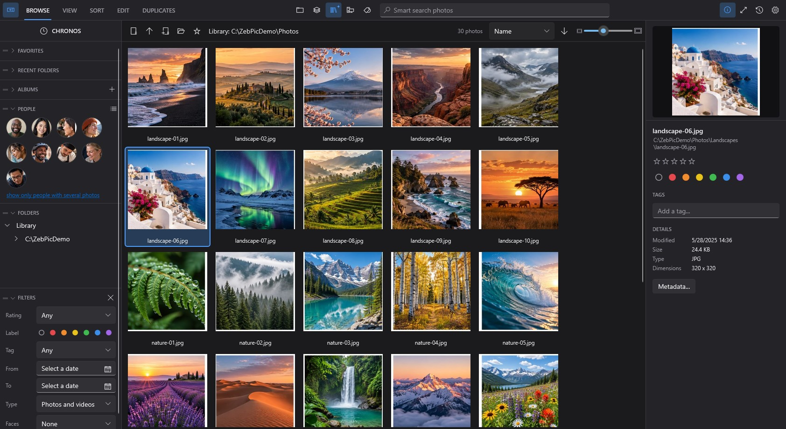
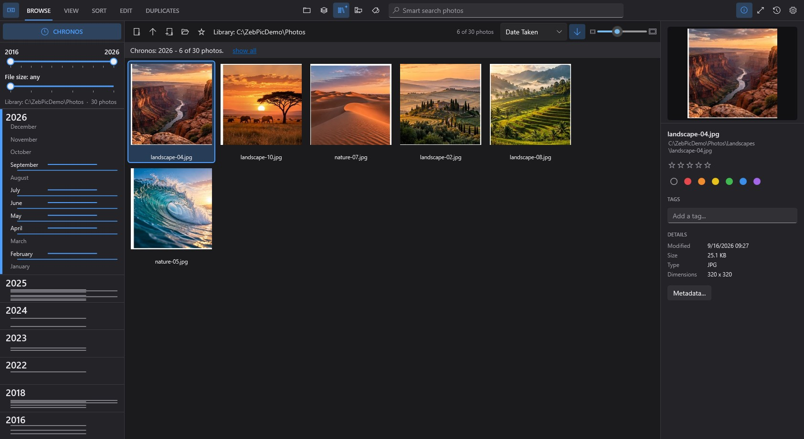

# ZebPic

Photo and video viewer, organizer, sorter, duplicate finder and photo editor for Windows - with smart search that
finds photos by what is on them and by the people on them, running entirely on your computer.

**[Download the latest version](https://github.com/greener101/ZebPic/releases/latest)**

| File | What it is |
| --- | --- |
| [ZebPic-Setup.exe](https://github.com/greener101/ZebPic/releases/latest/download/ZebPic-Setup.exe) | Installer: Start Menu entry, optional Desktop shortcut, "Open with" registration, uninstaller |
| [ZebPic-Portable.zip](https://github.com/greener101/ZebPic/releases/latest/download/ZebPic-Portable.zip) | Portable version: unzip anywhere and run `ZebPic.exe` |

### Beta versions

Test versions of the next release are published as pre-releases on the [Releases page](https://github.com/greener101/ZebPic/releases).
The check for updates at start-up offers stable versions only; Settings > Updates > Check for Updates also finds betas.
The links above always point to the latest stable version.

## Features

**Smart search** (optional, turned on in Settings)
- Find photos by a description in English or Russian: "sunset over the sea", "dog on a sofa", "people on stage".
- People: faces are grouped into persons; name a person and find their photos by the name.
- Works on the Library - the folders you choose, even a whole drive or an external disk. Everything runs on your
  computer; photos are not sent anywhere.

**Chronos**
- All photos by date in one column; the mouse wheel opens a year into months and days, a click shows only that time.

**Browse**
- Fast, resizable thumbnail grid for folders with thousands of files; folder tree, favorites, recent folders.
- Photos and videos side by side; filter by type, rating, color label, tag and date.
- Search by name, extension, tag, rating, label, camera and lens.
- Look in this folder, the folder with its subfolders, the Library, every disk of the computer, or the marked photos.
- Folders refresh by themselves when files change on disk.

**View**
- Zoom at the cursor, pan, fit to window, 100 %, filmstrip, full screen.
- Plays videos (MP4, MOV, AVI, WMV, MKV) with play/pause, seek and volume.
- Shows where a photo was taken on a map, when the photo has GPS coordinates, and opens the place in the browser.

**Organize**
- Star ratings, color labels and tags, with keyboard shortcuts.
- They are stored in ZebPic's own database: your files are not modified.
- Albums: named lists of photos from any folders; the files stay where they are.
- Rename (F2), new folder, copy, cut, paste. Deleting always goes to the Windows Recycle Bin.

**Sort**
- Two folders side by side; drag and drop to move or copy, with a clear "Move 14 photos" indication before you drop.
- Per-panel filters and quick access to favorite, recent and sub-folders.

**Duplicates**
- Finds exact copies and visually similar photos (resized, recompressed, lightly edited).
- Scan a folder, several folders, a drive or the whole computer.
- Nothing is deleted without review; removed files go to the Recycle Bin.

**Edit**
- Light, color and sharpness adjustments; crop with aspect ratios (move and resize the frame with the mouse); resize; rotate and flip.
- Pencil, text captions, text or picture watermarks: choose a font, move and rotate them with the mouse, set opacity, optional embossed or engraved look.
- Undo and redo. The original file changes only when you choose Save; Save As creates a new file.
- Edit History keeps the version each Save replaced, so a saved edit can be undone later.

**Batch**
- Resize or watermark many photos at once. Results go to a separate subfolder; originals are changed only if you ask for it.

Dark and light themes. English and Russian interface.

## Requirements

- Windows 10 or Windows 11, 64-bit.
- Nothing else to install: .NET is included; the installer adds the Microsoft Visual C++ Redistributable when it is missing.
- Smart search downloads its components once (about 254 MB) when you turn it on.
- Photos: JPEG, PNG, BMP, TIFF, GIF. WEBP and HEIC/HEIF open when the matching Windows image extensions from Microsoft Store are installed.
- Videos play through the codecs installed in Windows. MP4, MOV, AVI and WMV work out of the box; some MKV and HEVC files need additional Windows codecs.

## Installing

Run `ZebPic-Setup.exe`. The installer is not digitally signed yet, so Windows SmartScreen may show a warning:
choose **More info**, then **Run anyway**.

To make ZebPic the default photo viewer, open Windows **Settings > Apps > Default apps**, choose ZebPic and pick the file types.

ZebPic checks this page for new versions and offers to update itself. Your ratings, tags, favorites and settings
are kept in `%LocalAppData%\ZebPic` and are preserved by updates and reinstalls.

## License

ZebPic is free for personal, non-commercial use. It may not be used at work or in an organization, sold or modified; see [LICENSE.txt](LICENSE.txt).
Components by other authors that are included in ZebPic are listed in [THIRD-PARTY-NOTICES.txt](THIRD-PARTY-NOTICES.txt).

## Feedback

Found a problem or have a suggestion? Open an [issue](https://github.com/greener101/ZebPic/issues).
For an error, Settings > About > Report a Problem saves a report file you can attach.

---

Developed by Home Soft Lab.

Pictures in the screenshots: ZebPicDemo - AI-generated demo image assets, [CC BY 4.0](https://creativecommons.org/licenses/by/4.0/); shown reduced in the program window. Details: [docs/DEMO-IMAGES.md](docs/DEMO-IMAGES.md).
